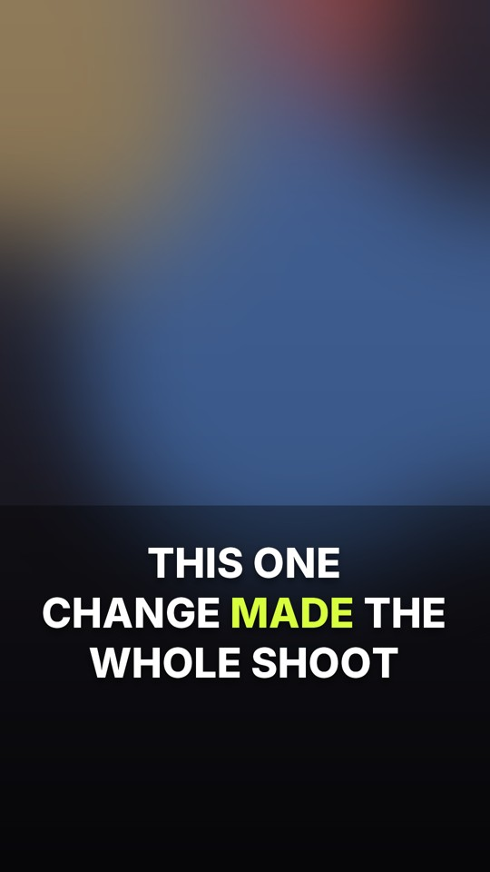
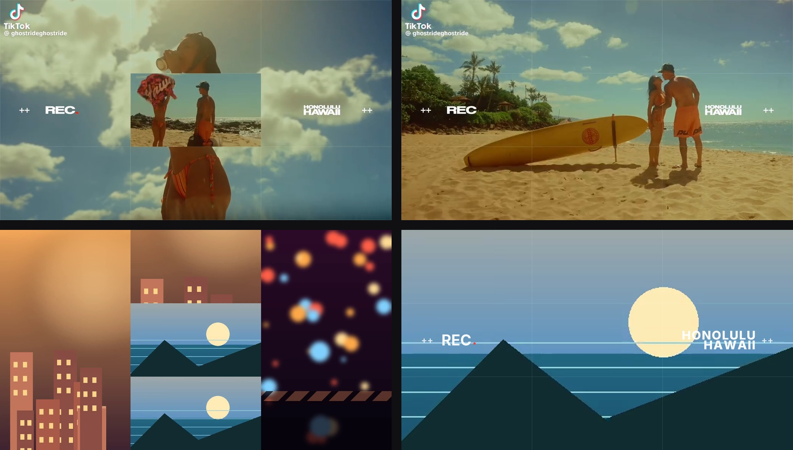
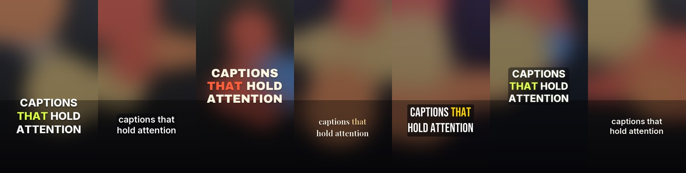

# Cutline

**A first-cut studio for DaVinci Resolve.** Auto-remove silences, add captions, add
titles, and lay in transitions — then hand the timeline to Resolve and keep editing.

Built for the free edition on purpose. Cutline installs a **Workspace → Scripts**
entry inside Resolve, so a finished cut can be pulled into the open project
without leaving the app — drop footage in a folder, and the menu item imports what
the engine has built. Underneath it is still a plain **OpenTimelineIO** timeline,
the same kind Resolve imports from an XML or EDL.



Three passes, three workflows:

| Pass | What it is for | It does |
|---|---|---|
| **Talking head** | Client social, vertical | Silence cuts, bold word-timed captions, light-leak/flash accents |
| **Travel vlog** | Journal or viewfinder | Gentle silence trims, title/chapter cards *or* a REC-grid collage open, journal captions |
| **Music video** | Beat-driven | Tempo detection, shot grid on the bar, beat accents, lyric captions |

Everything runs on your machine. No account, no upload, no cloud render.

### Two vlog looks

The vlog pass ships with the two styles travel work actually uses:

| Look | Built for | It adds |
|---|---|---|
| **Journal** | Long-form 16:9 travel films | Opening title card, one chapter card per location, warm journal captions |
| **Viewfinder** | Short cinematic edits (15–45 s) | A five-tile opening collage, a thin 3×3 grid, a `++ REC.` tag, and a stacked location card |

Viewfinder overlays are real media, never baked into your footage: the collage
lands on **V5** and the REC grid on **V6**, both above the program track. Toggle
either one off, or delete the track in Resolve and the cut is untouched. It
carries no title or chapter cards, which matches the reference the look is
modelled on.



*Top row: the reference frames. Bottom row: the same structure rendered by
Cutline — five-tile collage, grid, REC tag, location card.*

---

## What you get

- `timeline.otio` — video on V1, transitions on V2, captions on V3, title cards on V4,
  collage on V5, viewfinder overlay on V6, audio on A1
- `captions.srt` / `captions.vtt` — a subtitle sidecar if you would rather use Resolve's subtitle track
- `transcript.txt` — timed transcript of the cut
- `preview.jpg`, `manifest.json`, `cut_notes.md` — a still, the recipe, and import notes

Captions and titles are real QuickTime movies with an alpha channel, so they behave
like any clip you would drop on a track. You can slip a single card, retype it, or
delete the whole track without touching the picture.

### The test kit

Every finished cut also packs into a **test kit**: a zip with the timeline and
every file it references, rewritten to relative paths so it imports on any
machine — no Cutline install needed on the far side.

Download it from the result panel (**Resolve test kit**) or from the CLI:

```bash
cutline kit                 # newest finished cut
cutline kit 9c69ccaeb7c345  # a specific project
```

Unzip anywhere, keep `timeline.otio` beside `media/`, then **File → Import →
Timeline**. The kit's `READ-ME-FIRST.md` lists the exact things worth checking
(track order, alpha compositing, trimmability, source timecodes).

If a project links camera originals totalling more than 2 GB, the kit links
instead of copying and lists what must stay online.

## Inside Resolve

Free Resolve 21.1 runs Lua menu scripts but no longer runs Python from the Scripts
menu, and its Lua has no UI toolkit. So the engine lives outside Resolve and only
the import lives inside it. After the one-time `./install.sh` (see Quick start):

```bash
./bin/cutline resolve-install   # writes the Workspace → Scripts entries
./bin/cutline resolve-agent     # keeps the watcher running at login
```

1. Drop clips into `~/Movies/Cutline/inbox` (an optional matching `.srt` is picked up).
2. The watcher builds the cut and publishes it to `~/Movies/Cutline/latest/`.
3. In Resolve: **Workspace → Scripts → Cutline - import latest**.

The new timeline lands in the media pool and opens in the Edit page. Nothing is
baked: it is the same track stack as a hand import, only the tracks the cut uses.

`Cutline - check bridge` proves the menu entry can reach Resolve's API,
`cutline resolve-build` forces a build without waiting for the watcher, and
`cutline resolve-status` prints what the last build produced. Modes and
looks are set in `~/Movies/Cutline/config.json` — same schema as the studio.

Full setup, the free-edition limits, and troubleshooting:
**[docs/inside-resolve.md](docs/inside-resolve.md)**.

## Quick start

New to this? **[INSTALL.md](INSTALL.md)** is the step-by-step macOS walkthrough,
including the Resolve menu setup. No Terminal at all: download
[the one-click installer](https://github.com/vipervisuals14/videoeditor/raw/arena/baa7f9aa-videoeditor/downloads/cutline-installer.zip),
unzip it, and double-click `Install Cutline.command`.

```bash
git clone <your-repo> cutline && cd cutline
./install.sh          # macOS / Linux
./bin/cutline serve   # opens http://127.0.0.1:8787
```

On Windows run `install-windows.bat`, then double-click `Cutline.bat`.

First launch renders a small demo clip and caption file so you can try a full build
in under a minute — press **Add demo footage**.

### Requirements

- Python 3.10+ (3.11 or 3.12 recommended for the optional speech engine)
- FFmpeg (bundled automatically through `imageio-ffmpeg`; a system FFmpeg also works)
- DaVinci Resolve 18.5 or newer, free or Studio

Automatic captions use [faster-whisper](https://github.com/SYSTRAN/faster-whisper)
running locally (installed by `install.sh`). The first transcription downloads a
75–500 MB model depending on quality. If you would rather not, upload an `.srt`,
`.vtt`, or `.lrc` file instead — everything else works the same.

## Using it

1. **Footage** — drop clips, or paste a folder path to use media already on your drive.
2. **Silence** — pick a pacing, check the silence map, and see exactly how much dead
   air is coming out. The detector learns the room tone per clip.
3. **Captions** — transcribe, upload a file, or turn text off. Choose one of seven
   looks and tune type, colour, highlight, entrance, and position against a live preview.
4. **Motion** — transitions (light leak, film burn, flash, glitch, soft bloom, whip,
   dip to ink, or your own alpha movie) and, for vlogs, title and chapter cards.
   Vlogs also choose a look: **Journal** (title and chapter cards) or **Viewfinder**
   (opening collage plus REC-grid overlay), each with its own switches.
5. **Delivery** — aspect, frame rate, resolution. Build.

Then in Resolve: **File → Import → Timeline**, pick `timeline.otio`, and accept the
media relink. Done.

### Silence pacing

| Preset | Cuts pauses over | Feel |
|---|---|---|
| Natural | 0.9 s | Travel films, interviews with air |
| Tight | 0.55 s | Podcast-style social edits (default) |
| Surgical | 0.32 s | Shorts, fast retention editing |

### Caption styles

Seven presets: **Creator** (bold, word-highlight), **Clean** (soft card), **Kinetic**
(editorial music type), **Journal** (warm travel serif), **Broadcast** (newsroom
lower third), **Neon** (karaoke colour), **Minimal** (clean outline). All are
customisable and the whole look is re-rendered from the settings.



### Music mode

Cutline decodes the song, estimates tempo and downbeat phase, and cuts picture every
N beats. Beat accents land on the bar. Lyric captions can come from transcription or
an `.lrc`/`.srt` file. If detection is unsure, type the BPM and rebuild.

## Why a menu script and a studio, not a plugin

A native Resolve plugin can't do this on the free edition. OpenFX and Fusion
templates process one clip's pixels and can't build a timeline. The scripting API
is what *can* build one, which is why Cutline puts a small Lua entry in the
Scripts menu — but external scripting is Studio-only and Free has no UI toolkit
for scripts, so the analysis and rendering stay in the local engine and the menu
entry only imports the result. Timeline interchange is the one interface
Blackmagic left open on both editions, so that is what the engine targets.

More detail: [docs/why-not-a-plugin.md](docs/why-not-a-plugin.md).

## How the free edition is handled

Resolve 19.1 moved external scripting to Studio, and 21.1 removed Python scripting
from the free edition altogether. File interchange was not touched: OTIO import (and
EDL/FCPXML) still works on Free. Cutline is built entirely on that path:

- no dependency on Studio-only API calls: the menu entry is Lua, and the Python
  entry is a convenience for Studio owners (Free ignores it)
- no UIManager, no docked panel, no window that only exists on Studio
- stock OTIO schemas only (custom schemas are known to make the importer fail)
- absolute media paths, so the conform is silent
- audio-first track order with video layered bottom-to-top, matching a verified import

The one platform caveat worth knowing: **Free on Linux cannot decode H.264/H.265**.
On macOS and Windows the free edition decodes camera files normally. On Linux, work
with DNxHR/ProRes media if you are on the free build.

## CLI

```bash
cutline serve          # start the studio (default)
cutline serve --port 9000 --no-browser
cutline doctor         # check FFmpeg, fonts, OTIO, and the speech engine
cutline demo --force   # regenerate the demo footage
cutline kit            # package the newest cut for a Resolve import elsewhere
cutline resolve-install   # add Cutline to Resolve's Workspace → Scripts menu
cutline resolve-watch     # watch the drop folder and rebuild on changes
cutline resolve-build     # build the drop folder once, now
cutline resolve-status    # what the last drop-box build produced
cutline resolve-agent     # install the macOS login item for the watcher
cutline clean --uploads
```

Data lives in `./data` (projects, uploads, renders, models). Override with
`CUTLINE_DATA=/path/to/folder`.

`cutline serve` listens on all interfaces so it also works in containers and on a
render box. On a shared network, start it with `cutline serve --host 127.0.0.1` to
keep the studio local to your machine.

## Project layout

```
cutline/
  app.py            FastAPI routes and job runner
  pipeline.py       the build: silence → captions → overlays → timeline
  silence.py        room-tone learning and speech-run detection
  beats.py          spectral-flux onsets, tempo, downbeat phase
  transcribe.py     faster-whisper wrapper with word timestamps
  captioning.py     cue building, re-timing after cuts, manual edits
  captions.py       the caption renderer (Pillow + bundled fonts)
  transitions.py    procedural light leak / flash / glitch / bloom / whip
  transition_render.py  bakes accents with the real footage underneath
  timeline.py       OTIO writer (contiguous tracks, source ranges intact)
  planner.py        edit decision lists for all three modes
  resolve_bridge.py Resolve menu scripts, drop-folder watcher, login item
  static/           the studio UI (no build step, no framework)
tests/              81 tests across analysis, planning, rendering, the API, and
                    the Lua bridge (driven by a fake Resolve in a Lua runtime)
docs/inside-resolve.md  the in-app setup and the free-edition scripting limits
docs/images/        screenshots used in this README
```

## Notes and limits

- Everything is frame-quantised; 23.976/29.97 totals can differ by a frame or two.
- Transition accents are baked into short movie clips because OTIO dissolves need an
  overlap the free importer doesn't honour reliably. Cuts stay frame-accurate.
- Captions are burned-in overlays; the SRT is the editable source of truth.
- Beat detection is solid on four-on-the-floor material and approximate on rubato
  live recordings — type the BPM to lock it.
- Not affiliated with Blackmagic Design. “DaVinci Resolve” is a trademark of
  Blackmagic Design Pty Ltd.

## Licence

MIT for the code. Bundled fonts (Inter, Archivo Black, Bebas Neue, Playfair Display)
are under the SIL Open Font License; see `cutline/assets/licenses/`.
