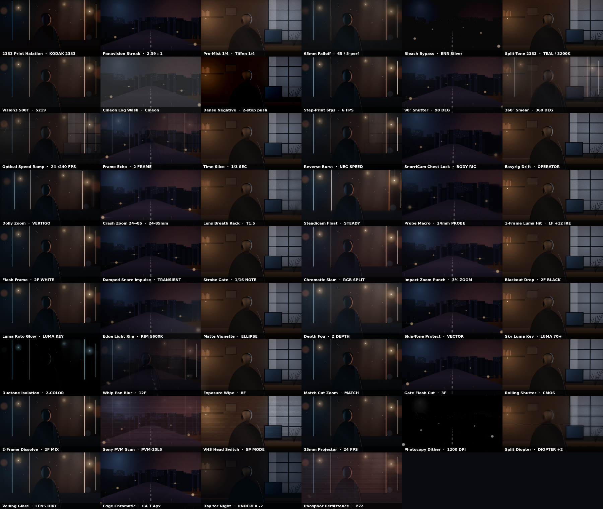
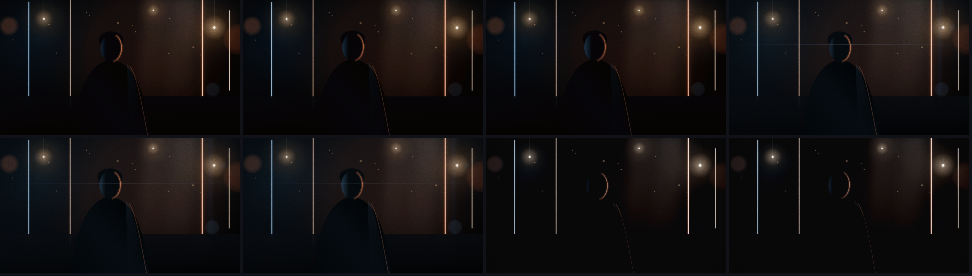

# PulseVFX Studio — DaVinci Resolve Free 21.1.1 Pop-Up Extension

A floating companion panel and timeline automation suite built for **DaVinci Resolve Free 21.1.1** — no Studio license, no paid plugin packs, no browser extensions.

Four work surfaces, all driving native Resolve / Fusion:

1. **Optical & VFX** — 52 film-craft treatments (print stock, shutter behaviour, camera rig physics, analogue signal) with a look-prompt pass, live parameter tweaking, and a side-by-side **Style Lab**.
2. **LYRC Typography** — 20 kinetic lyric compositions inspired by LYRC.studio, plus editorial talking-head captions, Variation seeds, and a reusable Song Template.
3. **Cut Silences** — noise-floor gate, minimum pause window, pre/post-roll handles, jump-cut reframe, and a click-to-override decision list.
4. **Media Pool Cut** — reads the open project's bins and assembles a beat-locked music video or an A-roll/B-roll editorial cut.

---

## What's new in this build

### The VFX library was rebuilt around film craft, not "shake / zoom / glitch"

The previous grid was a list of internet effect names. The new one is organised by **the physical thing that produces the look**, and every card shows the native node chain it maps to.

| Category | Count | Examples |
|---|---|---|
| Optical & Film | 13 | `2383 Print Halation`, `Panavision Streak`, `Pro-Mist 1/4`, `65mm Falloff`, `Bleach Bypass`, `Split-Tone 2383`, `Vision3 500T`, `Cineon Log Wash`, `Dense Negative`, `Split Diopter`, `Veiling Glare`, `Edge Chromatic`, `Day for Night` |
| Shutter & Time | 7 | `Step-Print 6fps`, `90° Shutter`, `360° Smear`, `Optical Speed Ramp`, `Frame Echo`, `Time Slice`, `Reverse Burst` |
| Camera Rig | 7 | `SnorriCam Chest Lock`, `Easyrig Drift`, `Dolly Zoom`, `Crash Zoom 24→85`, `Lens Breath Rack`, `Steadicam Float`, `Probe Macro` |
| Hits / Exposure | 7 | `1-Frame Luma Hit`, `Flash Frame`, `Damped Snare Impulse`, `Strobe Gate`, `Chromatic Slam`, `Impact Zoom Punch`, `Blackout Drop` |
| Roto & Matte | 7 | `Luma Roto Glow`, `Edge Light Rim`, `Matte Vignette`, `Depth Fog`, `Skin-Tone Protect`, `Sky Luma Key`, `Duotone Isolation` |
| Transitions | 6 | `Whip Pan Blur`, `Exposure Wipe`, `Match Cut Zoom`, `Gate Flash Cut`, `Rolling Shutter`, `2-Frame Dissolve` |
| Analogue Signal | 5 | `Sony PVM Scan`, `VHS Head Switch`, `35mm Projector`, `Photocopy Dither`, `Phosphor Persistence` |

**Why these read as expensive instead of corny**

- **Highlights are isolated by luminance, not by a colour overlay.** `2383 Print Halation`, `Panavision Streak`, `Luma Roto Glow`, `Duotone Isolation` and `Sky Luma Key` all run through a real highlight-isolation pass: the plate is mapped so only its top stops survive, tinted, blurred, and screened back. Bloom lands on bulbs, skin and speculars — not on the whole frame.
- **Motion is physical.** `SnorriCam Chest Lock` holds the subject sharp while the plate counter-rotates; `Easyrig Drift` is a sub-degree operator sway; `Lens Breath Rack` is a focus pull with breathing; `Step-Print 6fps` quantises time to a print cadence instead of stuttering the frame.
- **Impulses decay.** Hits use an exponential envelope keyed to the project BPM (`Damped Snare Impulse` = 1.5px scale + micro bloom, gone in ~90 ms), so they read as impact rather than a wobble.
- **The plates are lit like sets.** Four preview plates — `Stage • Practicals` (LED tubes, bare bulbs, haze), `Night • Rollers` (wet asphalt, skyline, headlight streaks), `Window • Interview` (practical lamp, window key, monitor), and `Neutral Slate` — are procedurally lit so bloom, focus and grain have something real to react to. **Load Footage / Still** swaps any of them for your own `.mp4 / .mov / .webm` clip or a `.jpg / .png` frame.
- **The preview protects its own frame rate.** Resolution steps 100% → 80% → 62% when a heavy pass (halation, diffusion, split diopter) costs more than ~26 ms per frame, and climbs back when there is headroom. The current scale is shown next to the timecode.



### Style Lab (A/B/C/D comparison)

Open **Style Lab** in the viewer toolbar to render eight candidates at the **same three timestamps**, in a 3-up strip per card. Compare `2383 Print Halation` against `Bleach Bypass` and `Day for Night` on identical frames, then click a card to apply it to the monitor and queue the native node. The **LYRC Styles** tab does the same for typography at identical phrase timing.



### Native Fusion macros

`fusion-macros/` now ships nine installable `.setting` macros, all built from stock Fusion tools (no third-party plugins):

| Macro | Built from |
|---|---|
| `VFXKit_PrintStockHalation` | `BrightnessContrast` → `SoftGlow` |
| `VFXKit_AnamorphicStreak` | `SoftGlow` (X 120 / Y 2) → `Merge` |
| `VFXKit_DrillCameraShake` | `CameraShake` |
| `VFXKit_ImpactEnergyHit` | `BrightnessContrast` → `Transform` → `SoftGlow` |
| `VFXKit_CRTRetroSignal` | `TV` |
| `VFXKit_ChromaBleedVHS` | `TV` (low scanline / tear / skew) |
| `VFXKit_AnalogGateWeave` | `CameraShake` → `TV` |
| `VFXKit_DampedSnareImpulse` | `Transform` → `SoftGlow` |
| `VFXKit_LyrcKineticEngine` | `Background` + `TextPlus` → `Merge` → `Transform` |

Each panel action also emits a **runnable Lua snippet** into the console drawer (`Copy Lua`), so you can paste into `Workspace ▸ Console ▸ Lua` if the resident bridge isn't running.

---

## Quick start (macOS · Resolve Free 21.1.1)

```bash
# 1. Install the Lua bridge + all native Fusion macros into the Resolve paths
./install-macos-resolve-free.sh

# 2. Start the panel
npm start          # http://localhost:3000
```

3. In Resolve Free 21.1.1, open your project and run once per session:
   `Workspace ▸ Scripts ▸ VFXKit_ResolveFree_Bridge`
4. Keep the panel beside the Resolve viewer. **Pop-Up Dock Mode** shrinks it to a narrow strip.
5. Optional: **Load Footage** in the top bar swaps the procedural plate for any local `.mp4 / .mov / .webm`, so previews run on your own shots.

Installed paths:

- Script: `~/Library/Application Support/Blackmagic Design/DaVinci Resolve/Fusion/Scripts/Utility/VFXKit_ResolveFree_Bridge.lua`
- Macros: `~/Library/Application Support/Blackmagic Design/DaVinci Resolve/Fusion/Templates/Edit/Effects/VFXKit Free/`
- Mailbox: `~/.vfxkit-resolve-free/request.lua`
- Response: `Fusion.prefs → Response = "<id>:<hex-encoded JSON>"`

---

## How the Resolve Free 21.1.1 wall is bypassed

- Resolve 19.1 moved `UIManager` and Workflow Integrations to Studio.
- Resolve 21.1 / 21.1.1 removed `.py` script execution from the Free tier and sandboxed Lua (`io`, `os.execute`, `require` are `nil`).
- Still open in Free: `Workspace ▸ Scripts` runs `.lua` with full access to `resolve`, `Project`, `MediaPool`, `Timeline`, `Fusion`, plus `loadfile()`, `bmd.fileexists()`, `bmd.wait()`, and `fusion:SetPrefs()` / `SavePrefs()`.

The resident bridge polls a request file with `loadfile()` and answers through `Fusion.prefs`, giving roughly 50 ms round-trip control of the open project — no Studio, no external sockets.

---

## Files

```
server.js                              Zero-dependency Node server (:3000) + /api/dispatch + Lua generator
resolve-bridge/VFXKit_ResolveFree_Bridge.lua   Resident mailbox bridge (Lua 5.1)
fusion-macros/*.setting                Nine native Fusion macros
install-macos-resolve-free.sh          Copies bridge + macros into Resolve paths
public/index.html                      Panel UI (4 tabs, Style Lab, viewer, timeline)
public/styles.css                      Dark editorial UI
public/app.js                          Preset library, 60 fps canvas engine, LYRC typesetter
```

## Verification

- All 52 VFX presets and 20 LYRC presets render in a headless jsdom + canvas harness with **zero runtime errors**.
- All eight dispatch actions (`apply_vfx`, `build_look_pass`, `cut_silences`, `add_captions_lyrics`, `shuffle_template_clips`, `scan_media_pool`, `auto_edit_timeline`) generate Lua that **compiles under Lua 5.1**; the resident bridge script also compiles.
- Keyboard: `Space` play/pause, `←/→` scrub.
