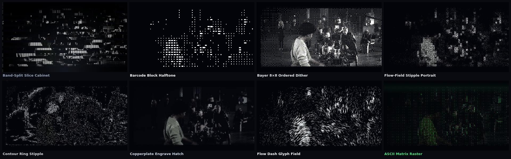
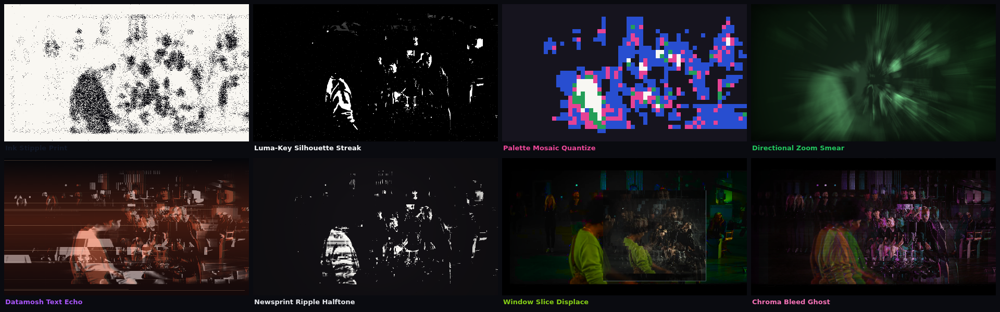
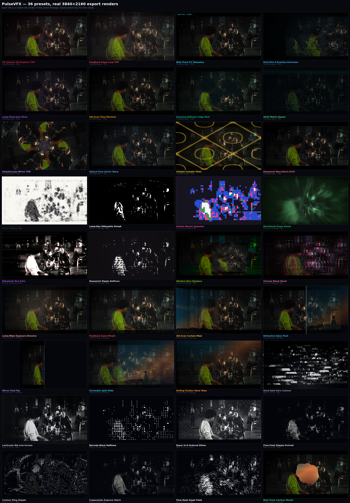
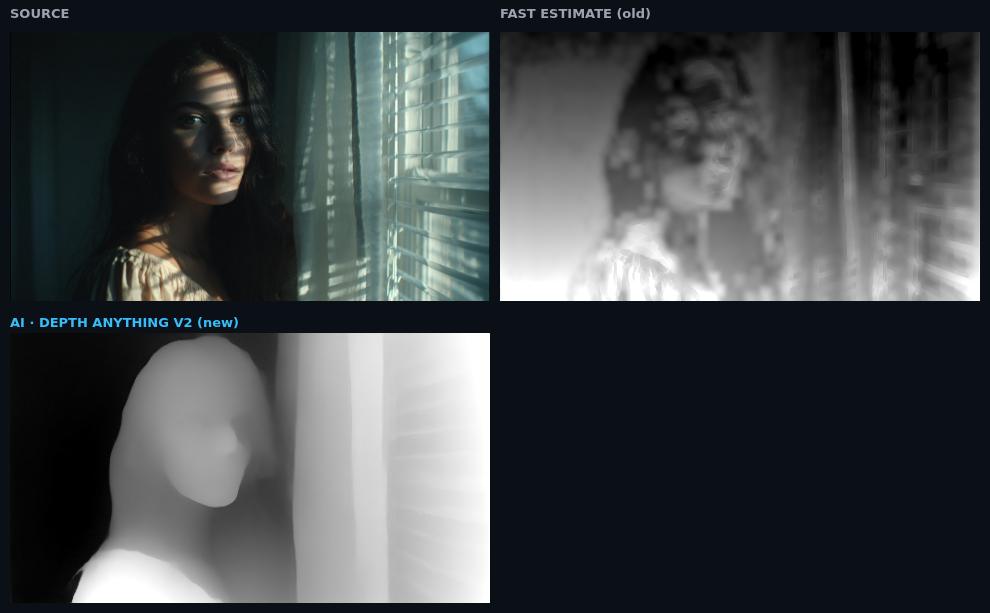
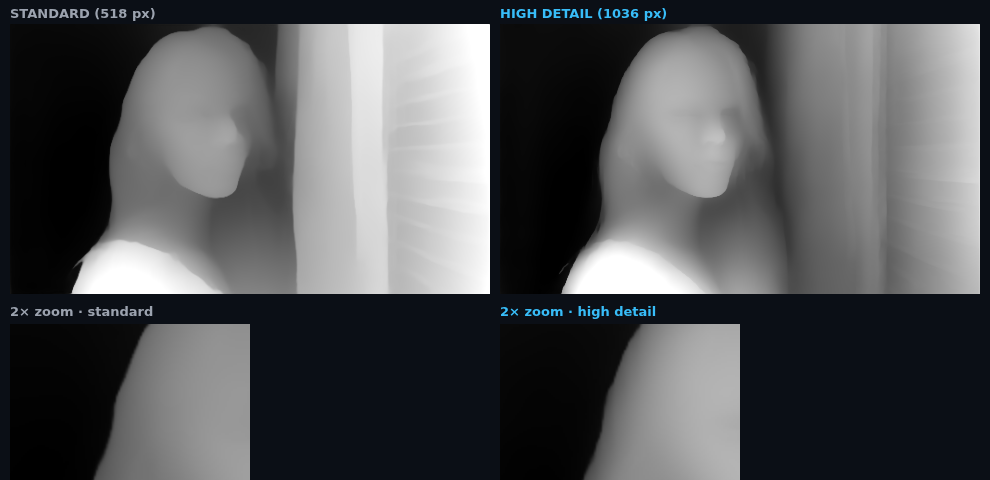

# PulseVFX Kit — DaVinci Resolve Free 21.1.1 Pop-Up Extension & AI Editor

An all-in-one floating pop-up extension and timeline automation suite built specifically for **DaVinci Resolve Free 21.1.1** (macOS, Windows, Linux) — **no $295 Studio license and no paid third-party plugins (Sapphire/Universe) required.**

Inspired by **StayCreative's VFX Kit 2.0**, **AutoSubs v3.10+**, and **davinci-resolve-lua-mcp**, tailored for:
1. **Music Videos with High-Impact VFX** (7 tabs: *Roto FX, Shakes, Grunge FX, Transitions, Hits, Speed Ramps, CRT* + AI Prompt Builder & Quick-Adjust Sliders)
2. **Cut Silences** (Dead-air stripping + automatic 1.08x jump-cut punch-in zooms & J-cuts for talking-head brand videos)
3. **Subtitles & Social Media Lyric Videos** (Beat-synced kinetic artist lyrics + Hormozi/Pill talking-head word-by-word captions)
4. **Media Pool Smart Auto-Editor** (Reads your open Resolve Media Pool bins & clips and auto-cuts a beat-synced Music Video or Talking-Head Vlog timeline)

---

## The stage starts empty — on purpose

Five tabs: **Effects · Lyrics · Subject (Mask · Depth) · Editing (Silences · Media Pool) · Render**.
Inside Effects, the keyframe editor appears only after you pick a card, and the Look Director and
Effect Layers live behind a **More tools** toggle.

The preview sits at the **top of the page** and holds nothing until you load something.
There are no stock clips, no generated stand-in plates and no demo footage in the build;
the app opens on a dark frame that says **"Nothing loaded yet"**.

| | Behaviour |
| --- | --- |
| Footage | blank until you press **Load footage** / **Load photo**, or drop a file on the frame |
| Playback | never starts by itself. **Play / Pause** is the only thing that moves the picture |
| Lyrics | off at boot. Turn them on in `02 • Lyrics` or with the **Lyrics: OFF** button |
| Timeline | empty. Clips appear only after you apply an effect |
| Cut Silences | no analysis, no cuts and no timeline changes until you press **Detect silence** |

Loading a file loads it **paused, at 0:00**. Clearing the stage (**Clear**) puts everything back
to that blank, paused state.

---

## Research Findings: How to Build a Pop-Up Plugin for DaVinci Resolve Free 21.1.1

### 1. How StayCreative VFX Kit Works
StayCreative's VFX Kit (`staycreative.store/pages/vfx-kit-extension`, created by *LurkingVisuals*) is built around four UX pillars:
- **Categorized Native Presets (7 Tabs):** *Roto FX, Shakes, Grunge FX, Transitions, Hits, Speed Ramps, CRT* built from native host nodes so editors don't need paid Sapphire/Universe plugins.
- **Live Visual Previews:** Hovering/clicking presets shows the exact motion and color vibe before committing.
- **AI Prompt Assistant:** Typing a vibe prompt (*"drill, high energy, 808 shakes on beat, grunge flashes"*) automatically populates effects across the timeline.
- **Quick-Adjust Category Sliders:** Fine-tune category intensity after the AI pass without losing manual edits.

### 2. The DaVinci Resolve Free 21.1.1 Technical Wall (And How We Bypass It)
- In **Resolve 19.1**, Blackmagic locked `UIManager` (Resolve's internal GUI window builder) and `Workflow Integrations` behind Resolve Studio.
- In **Resolve 21.1 / 21.1.1** (Sept/Oct 2026), Blackmagic removed Python (`.py`) script execution from Resolve Free (`Workspace ▸ Scripts` ignores `.py` files) and sandboxed the built-in Lua runtime (`io`, `os.execute`, `require`, and `UIManager` are `nil`).
- **What Remains Open in Resolve Free 21.1.1:**
  - `Workspace ▸ Scripts` still executes `.lua` scripts with full access to `resolve`, `fusion`, `Project`, `MediaPool`, `Timeline`, `AppendToTimeline()`, `AddFusionComp()`, `AddMarker()`, etc.
  - `loadfile()` still executes external Lua table chunks from disk, and `fusion:SetPrefs()` + `fusion:SavePrefs()` still flushes responses to `Fusion.prefs` on disk.
- **Our Solution (`resolve-bridge/VFXKit_ResolveFree_Bridge.lua`):**
  - Uses the **Lua File-Mailbox + `Fusion.prefs` Bridge** (~50ms round-trip latency) paired with this **Floating Pop-Up Web/Desktop UI** and native **Fusion `.setting` Macros** (`fusion-macros/`).

---

## Two ways to run it

| | **Web version** (no installs) | **Desktop version** (one-click apply) |
| --- | --- | --- |
| Setup | deploy a static folder, or open a hosted URL | Node.js + 3 double-clicks ([INSTALL.md](INSTALL.md)) |
| Applying an effect | press **+ Apply** → paste one Lua snippet into `Workspace ▸ Console` | press **+ Apply** → done |
| Everything else (72 live cards, 4K shaders, sliders, keyframes, LYRC styles) | identical | identical |

Build the web bundle with `node tools/build-web.mjs` and deploy `dist-web/` — see
**[DEPLOY-WEB.md](DEPLOY-WEB.md)** for GitHub Pages / Netlify / Vercel / Cloudflare, including
the exact click-path in Resolve.

---

## Quick Start (macOS & DaVinci Resolve Free 21.1.1)

**Never used a terminal? Read [INSTALL.md](INSTALL.md) instead — it is a click-by-click manual
with every download link, and it needs no typing at all.** In short: install
[Node.js](https://nodejs.org/en/download), then double-click **`Mac 1 - Install Resolve
Bridge.command`**, then **`Mac 2 - Start VFX Panel.command`**, then click
`Workspace ▸ Scripts ▸ VFXKit_ResolveFree_Bridge` inside Resolve.

For the terminal-inclined:

```bash
# 1. Install the Lua Bridge & Native Fusion .setting Macros into macOS Resolve paths:
./install-macos-resolve-free.sh

# 2. Start the PulseVFX Pop-Up Panel Server:
npm start

# 3. Optional: floating app-style window instead of a browser tab
open -na "Google Chrome" --args --app=http://localhost:3000 --window-size=480,1120
```

3. In **DaVinci Resolve Free 21.1.1**, open your project and click once per session:
   `Workspace ▸ Scripts ▸ VFXKit_ResolveFree_Bridge`
4. Keep the **PulseVFX Pop-Up Panel** open next to Resolve (use **Pop-Up Dock Mode** in the top bar for a narrow floating strip).

---

## TouchDesigner-Style TOP Distortions, Transitions, Intensity & Keyframes

The panel now ships **72 presets across 10 categories**, including a real generative
canvas runtime (`public/touchdesigner.js`) that runs entirely in the browser — no
plugins, no Resolve Studio.

### TouchDesigner TOPs (12)
| Preset | Emulates |
| --- | --- |
| TD Simplex UV Displace TOP | `Noise TOP (Simplex 4D) ▸ Displace TOP` |
| Feedback Slope Loop TOP | `Feedback TOP ▸ Transform ▸ Level` |
| Blob Track CV Telemetry | `Threshold ▸ Blob Track ▸ Info CHOP` (bboxes, centroids, vectors) |
| Rutt-Etra Z-Scanline Extrusion | 1978 Rutt-Etra scanline luma→Z displacement |
| Luma Pixel-Sort Slicer | luma-threshold vertical pixel sorting |
| Slit-Scan Time Machine | temporal slit-scan curtain |
| Reaction-Diffusion Edge Melt | Gray-Scott style organic melt |
| ASCII Matrix Raster | `CHOP to DAT ▸ Text TOP` glyph raster |
| Kaleidoscope Mirror TOP | 8-wedge polar mirroring |
| Optical Flow Vector Warp | curl-noise advection + vector field |
| Chladni Cymatic Plate | standing-wave nodal displacement map |
| Datamosh Macroblock Drift | P-frame macroblock hold/displace |

### Data & Print TOPs (8) — reference-matched monochrome family
Built from the supplied TouchDesigner reference set (data/print corner of TOP work):
| Preset | Reference mechanic |
| --- | --- |
| Band-Split Slice Cabinet | horizontal slab decomposition, per-slab noise offset, lenticular rib screen, dark plinth + vignette |
| Lenticular Rib Line-Screen | full-frame vertical rib sheet (dark rib + bright lens crest) over a toned mono plate |
| Barcode Block Halftone | crisp white horizontal bars whose length = cell luminance, 48×30 grid |
| Bayer 8×8 Ordered Dither | true ordered-dither 1-bit print conversion, auto-levelled plate |
| Flow-Field Stipple Portrait | frame-space grain lattice (identical at 1080p and 4K), dot density + size following auto-levelled luma, contour-tangent shear |
| Contour Ring Stipple | dots placed on the iso-luma contours of the plate — the field literally traces the subject's topography |
| Copperplate Engrave Hatch | real burin hatch: one 34° line field masked into three tone bands (+ cross-hatch in shadow), stroke **weight** builds tone |
| Flow Dash Glyph Field | oriented dashes following the image gradient, length tracking luma |



### Glitch & Bitmap TOPs (8) — degraded-signal family
Matched to the second reference set (ink prints, luma-key cut-outs, bitmap posters,
smears and chroma ghosts). Same rules as the rest: intensity 0–200% + keyframes.

| Preset | Reference mechanic |
| --- | --- |
| Ink Stipple Print | inverted plate: black ink specks on white stock, density from tone + contour emphasis, occasional drag ticks |
| Luma-Key Silhouette Streak | hard luma key to pure white, horizontal trail streaks tearing off the edges, sensor grain |
| Palette Mosaic Quantize | resolution-crushed blocks posterised to a 5-colour palette with tone-banded assignment |
| Directional Zoom Smear | 16-tap normalised zoom smear + single-hue green duotone with forest falloff |
| Datamosh Text Echo | macroblock P-frame smear with periodic hard tears, a rust mid-band wash and red/cyan offset ghosts |
| Newsprint Ripple Halftone | true halftone dot screen whose pitch grows with the frame (dots stay a visible screen at 4K) with a ripple warp slicing through it |
| Window Slice Displace | rectangular window carved out and refilled with sliced, chroma-boosted duplicates |
| Chroma Bleed Ghost | duotone field with magenta/cyan edge-difference ghosts and tear bands |



---

## The look browser is a menu, not one long list

72 cards in a single scroll is a catalogue, not a tool. The browser now opens as
**sections** — one row of buttons, nothing listed until you pick one:

| Section | Looks | What lives there |
| --- | --- | --- |
| **Optical & Glass** | 12 | flare, streak, prism, halation, lens dirt, gate weave |
| **Shutter & Time** | 12 | smear, echo, velocity streak, rolling shutter, step-print |
| **Film Lab & Grade** | 13 | 2383, bleach bypass, litho, FLIR, push/pull, halation stocks |
| **Camera Weight** | 12 | float, thump, whip, dutch, dolly punch, handheld |
| **Depth & Subject** | 12 | subject isolation, depth haze, plane rack, spill light |
| **Editorial Polish** | 11 | scope bars, frame guides, matte, framing, splice |
| **Transitions & Morphs** | 8 | the TouchDesigner family (luma wipe, feedback zoom, mirror fold…) |

- Each button carries its look count, so you can see where the weight is before clicking.
- **One section open at a time.** Picking another closes the first — the grid never grows
  past a screenful, which is the whole point.
- The search field still spans **all** presets: type `flare` and it opens a filtered result
  set regardless of which section you were in. `#fxResultsNote` says `Pick a section`,
  `N looks` or `N matches` so the state is never ambiguous.
- An effect is only ever added by clicking it. Opening a section, hovering a card, loading a
  clip — none of those apply anything.

## 4K Export Verification (all 72 presets)

Every preset was rendered at a true **3840×2160** with `TD_ENGINE.setQuality('export')`
and inspected at **1:1 pixel crops** — not thumbnails, not upscales. The pass found and
fixed a whole class of "looks fine at 720p, falls apart at 4K" bugs:

| Bug class | What went wrong | Fix |
| --- | --- | --- |
| Print screens authored in buffer pixels | stipple / halftone / dither lattices became sub-pixel noise at 4K, so tone survived but the texture vanished | screens are now authored in **frame pixels** (`rpx()` / a resolution-aware pitch) and dot radius scales with the pitch, so the screen frequency reads the same at 1080p and 4K |
| Fixed-pixel line drawing | lenticular ribs, engrave hatch and scan lines turned into 1px moiré wash across the frame | ribs are a repeating **lens-shading pattern** (multiply) at a frame-space pitch; hatch strokes scale with the cell |
| Flat-bar rib screen | black bars down the whole frame read as a barcode, not glass | replaced with a cosine lens ramp composited in `multiply`, so ribs survive inside blown highlights |
| Feedback drawn onto itself | `ctx.drawImage(fb)` through a transform is undefined in canvas and produced stair-step garbage once the source moved | new `feedbackStep()` transforms the previous buffer into a scratch canvas first, then rebuilds it as a bounded **EMA** `FB = FB·decay + src·(1−decay)` |
| Low-key footage killed print effects | a dark plate sits entirely below the ink threshold, so stipple / halftone / engrave / mosaic rendered almost black | every tonal shader now runs **auto-levels** (5–98 percentile of the current plate, with a small raw blend) before mapping tone |
| Soft 1400px mono plates | band-slice / lenticular plates were upscaled ~3× and looked like oil paintings | plate now renders at ~45–60% of frame width (up to 2600px) with a filmic shoulder instead of clipping |
| Rib screen read as a grid overlay | isolated specular lines floated over a muddy plate | rib shading is a cosine **lens ramp** multiplied into the plate with a thin crest, and the plate is composited at full strength |
| Coarse halftone tear | 70 fixed bands meant 31px stair-steps at 4K | band count now follows frame height (`h/11`) with the ripple amplitude in frame pixels |
| Blocky stipple grain | square 4px blots at 0.75 buffer scale read as pixel art | finer frame-space lattice + one eroded corner per blot so the ink grain stays irregular |
| Print plates crushed to black | high contrast + high gamma clipped everything below the ink threshold | band-slice / lenticular plates now use 1.10–1.42 contrast at gamma 0.92–0.95 |
| Skyline in the transition B-plate | every transition preview slid a bar-chart of black rectangles over the shot | replaced with an atmospheric plate (curved horizon, lone figure, sun, bokeh) |

Token/technique changes made during the pass: `Contour Ring Stipple` was rebuilt to place
dots on the **iso-luma contours** of the plate (it previously drew literal concentric
circles), `Copperplate Engrave Hatch` became a real burin plate (one line field masked into
three tone bands, cross-hatched in shadow, stroke weight carrying tone), `ASCII Matrix
Raster` became a true full-frame glyph raster that puts a character in **every** cell, and
`Datamosh Text Echo` was rebuilt around a mono plate + rust mid-band + red/cyan ghosts.

The second pass (after the panel was wired to Resolve) fixed what the first sheet still
showed at 1:1: `Flow-Field Stipple Portrait` gated its tone with a bilinear lookup from a
96×54 grid (nearest-neighbour had put stair-steps on every silhouette edge), `Flow Dash
Glyph Field` now drops the empty background instead of speckling the whole frame, the ASCII
raster reads as a monitor instead of a few dots, the lenticular rib screen became a cosine
lens ramp with a thin specular crest, the newsprint ripple slices at `h/11` so 4K no longer
stair-steps at 31px, and every print plate trades contrast for legibility
(1.10–1.42 at gamma 0.92–0.98) instead of crushing to black.



### Measured cost (Node + Skia, CPU only, one core — a Mac is several times faster)

| Path | Resolution | Total for all 72 | Average | Worst |
| --- | --- | --- | --- | --- |
| Interactive preview | 1280×720, `preview` | — | ~36 ms | 78 ms (`td_engrave`) |
| Full export render | 3840×2160, `export` | 6.10 s | ~85 ms | 442 ms (`tr_rollershutter`) |

The panel renders cards at preview quality, so scrolling and slider drags stay interactive;
export quality is used for the large preview, the still grab and the Resolve render.

---

## Native Resolve Integration — from a click to a real Fusion graph

Clicking **Apply** in the panel no longer sends a guessed node list. The server owns a
**per-preset recipe table** and the resident bridge is a small interpreter, so the exact
graph a preset produces can be retuned in JavaScript without re-installing anything into
Resolve.

```
public/app.js  ──POST /api/dispatch {action:"apply_vfx", presetId, intensity, keyframes}──▶ server.js
                                                                                            │
        resolve-bridge/preset-recipes.json ◀── recipeFor(presetId)                          │
                                                                                            ▼
     ~/.vfxkit-resolve-free/request.lua  ◀── write + rename (atomic) ────────────────────────┘
                     │
                     ▼
  VFXKit_ResolveFree_Bridge.lua  (Workspace ▸ Scripts, resident, 50 ms poll)
        comp:AddTool(...)  →  MediaIn1 → n1 → n2 → … → MediaOut1
                            + comp:BezierSpline():SetKeyFrames({[frame]={value}})
                     │
                     ▼
     Fusion.prefs  "VFXKitBridge.Response" = "<id>:<hex json>"  ──▶  panel toast + wire strip
```

### 77 native recipes across 11 families

`node tools/gen-recipes.js` regenerates `resolve-bridge/preset-recipes.json` from the panel's
own preset sources (`TD_PRESETS`, the `VFX_PRESETS` array, and the 20 `CAPTION_STYLES`), so
every card that ships is guaranteed to have a graph:

| family | count | family | count | family | count |
| --- | --- | --- | --- | --- | --- |
| `td` | 10 | `print` | 12 | `glitch` | 5 |
| `optical` | 7 | `transition` | 5 | `shutter` | 1 |
| `film` | 4 | `camera` | 3 | `depth` | 4 |
| `editorial` | 6 | `text` (LYRC) | 20 | | |

A recipe step is `{ tool, set?, bg?, fg?, source?, optional?, key?, input?, scale? }`:

- `bg` / `fg` / `source` select which input of a compositing node receives the previous
  node, the clip's `MediaIn1`, or both (that is how a `Merge` puts a TextPlus card over the
  plate).
- plain steps are wired through `Input`; generators (`Bitmap`, `TextPlus`, `FastNoise`)
  simply drop out of the image path instead of blacking the frame out.
- `optional` tools are skipped with `[skipped: X]`; a missing **required** tool falls back
  to `BrightnessContrast` and still applies.
- `key` marks the node whose input receives either the slider value
  (`intensity/100 * scale`) or a native `BezierSpline` at `frame = timeSec * 24`.
- the tail is always spliced into `MediaOut1`, and the result string reports the link count
  (`[wired 4 links to MediaOut1]`) so the panel can prove the graph is live.

### Kinetic lyrics become a real text comp

`add_captions_lyrics` creates one `TextPlus` card per cue (capped at 16), gives each card a
3-key `BezierSpline` on **Opacity** (out → in → out around its cue), merges every card over
`MediaIn1`, splices the stack into `MediaOut1`, and still stamps the yellow lyric markers.
The panel sends the cue list, the LYRC style id, the font size and the intensity, so the
same Song Template / Shuffle Clips arrangement that plays in the preview becomes native
Fusion nodes on the timeline.

### The panel knows whether Resolve is really listening

`GET /api/status` reads the bridge's `Session` pref, so the header pill turns green with the
**open project name** (`Live: Client Music Video · Resolve 21.1.1`), names the install target
when the bridge is not running, and shows the recipe coverage. Every dispatch prints the
graph that was wired in the strip above the Lua console, plus the `bridgeReason` when the
bridge did not answer.

---

## True 4K import and export (in the browser)

The hosted build is the product, so 4K has to work with nothing installed. `05 • Render`:

| Path | What it produces | Where it runs |
|---|---|---|
| **Export still** | one PNG / JPEG / WebP at up to 6K (4K UHD default) | your browser |
| **Render PNG sequence (ZIP)** | numbered `beauty/plate_00001.png …` frames, optional `depth/` and `matte/` passes, zipped in-page | your browser |
| **Render review .webm** | 4K review copy via MediaRecorder (codec-limited) | your browser |
| **Make Resolve render 4K natively** | the panel hands you a Lua snippet that sets the project + timeline to 3840×2160 and the render settings; Resolve renders final frames with real codecs | Resolve |

**Import** reads the real resolution of anything you drop in (`videoWidth/videoHeight` or
`naturalWidth/naturalHeight`) and tells you honestly whether it is 4K — a 1080p source can still
be exported at 4K, but the panel says so instead of pretending.

### How a 4K frame is composed without dying

`composeExportFrame()` runs the same pipeline as the monitor — plate → optical shader → depth
stack → effect layers → lyrics/mask overlays — but at export size. Depth work is **tiled**:
`planTiles()` splits the frame into 960×540 blocks with 48 px of real overlap, processes each
tile, and writes back only the inner rect, so blurs match seamlessly and peak memory stays near
one frame (~95 MB at 4K instead of ~400 MB). Sizes past the browser budget are refused with a
warning before a render starts, and every long job is cancellable with a progress bar.

The ZIP is written from scratch (`crc32` + store-only local/central directory), because PNGs are
already compressed — deflating again only burns battery. The output validates against
`python3 -m zipfile` and imports straight into Resolve's Media Pool or ffmpeg.

**Honest limits:** browsers cannot write ProRes or DNxHR, and MediaRecorder's WebM is a review
codec. For a finishing master, use the native Resolve path — same graph, Resolve's own renderer.

## Effect Layers — stack looks, in order

Under the Effect Browser is an optional **Effect Layers** rack. Pick a card, press
**＋ Add Current Effect**, repeat. Each layer keeps:

| Control | What it does |
|---|---|
| `1 2 3` index | stack order — bottom layers render first (`↑` / `↓` to move) |
| Blend | Normal, Screen, Multiply, Overlay, Lighten, Difference, Soft light |
| `FX` 0–200 % | that layer's intensity, keyframable with `◆` |
| `OP` 0–100 % | how much of the layer is visible |
| `◐` | mute without losing the settings |
| `✕` | remove |

The monitor composites up to four layers live (the rest still export), and
**Send Stack to Resolve** emits one ordered graph: `MediaIn → layer 1 → Merge →
layer 2 → Merge → … → MediaOut`, with every layer's opacity and blend operator
set, and a BezierSpline per animated layer. Distance/see-through rendering uses
the browser's own compositing, so what you see is what the graph builds.

## Depth map — a real model, not a guess

`03 • Subject ▸ Depth Map` drives 12 effects from a depth map, so the map decides whether the result looks
like a lens or like a smudge. There are now two engines, and the tab says which one produced the
map you are looking at.

| | **🧠 AI depth** (default) | **🔬 AI high detail** | **⚡ Fast estimate** |
|---|---|---|---|
| How | Depth Anything V2 Small, fp16 ONNX, 518 px | the same model at **1036 px** | image heuristics |
| Look | crisp silhouettes, smooth interiors, correct ground plane | resolves facial structure, hair strands, foliage | approximate; brightness bleeds into depth |
| Speed | ~2.5 s per frame | ~19 s per frame | instant |
| Cost | one-time **49 MB** cached download | **no extra download** | none |
| Honest use | live work, anything exported | a still you are about to finish | a rough read, and the fallback |



*Left: the source. Top right: the old heuristic, which reads the bright window and the blind
slats as "near" and the subject's face as "far". Bottom: the AI model, which returns the subject's
volume, her face relief, the wall behind her and the window recessed to the right.*



*The same model at 518 px and 1036 px. The 2× pass separates the jaw, the nose bridge and the
edge of the hair from the wall behind; the standard pass reads the head as one soft mass.*

`AI high detail` is a **still-frame tool**: it does not auto-refresh while the clip plays, because
a 19-second pass per frame would leave the tab permanently busy and never catch the picture. Press
`↻ Re-scan plate` (or switch a slider) to re-read the frame you are parked on.

### Why fp16 and not int8

An int8 build (26 MB) shipped first and was then removed — it lost on both axes at once:

| | int8 (26 MB) | **fp16 (49 MB)** |
|---|---|---|
| Agreement with a 1036 px reference | 0.8376 | **0.8585** |
| Detail vs that reference | 2.688× (quantisation noise, not detail) | **1.376×** |
| Inference, one WASM thread | 4.2 s | **2.5 s** |
| Session load | 594 ms | **371 ms** |

The smaller file was slower *and* grainier, so keeping it as a "budget" option would have made the
product worse while adding 26 MB to the repo.

### What runs where

- `public/depth-ai-worker.js` — a **module worker** that imports the vendored ONNX Runtime, feeds
  the model, and posts back a `Float32Array`. Runs off the main thread, so the 60 fps monitor and
  the lyric animation keep going.
- `public/vendor/depth/` — the fp16 model (49 MB), ONNX Runtime Web (52 KB of JS), its WASM backend
  (14 MB) and `NOTICE.md` with provenance, licences (Apache-2.0 model, MIT runtime) and the
  measurements above.
- The model is **not** downloaded at page load. It is fetched when you open the depth tab, switch a
  depth effect on, or click the AI card — and only once, because the browser caches it.

### Measured, not claimed

`node tools/test_depth_ai.mjs` loads the vendored model through the vendored runtime and checks it
on a procedurally rendered perspective scene:

| Check | Result |
|---|---|
| Output shape | `[1, 364, 518]` — read as H,W, not a channel dim |
| All values finite | yes (a 3-D/4-D mix-up is exactly how this used to fail) |
| Ordering | block **8.61** > near floor **5.30** > sky **0.00** |
| Panel convention (0 = near) | block **0.016**, sky **1.000** |
| Session load / inference | 0.8 s / 3.2 s on one WASM thread |
| High-detail (2×) pass | completes, uses the 1036 px grid, correct ordering |

Against the fp32 Python reference on a real photograph, the browser path correlates **0.9991**
(mean absolute error 0.0104); the whole residual is image resampling, PIL bicubic versus canvas.

### Where the map detail comes from

| | Before | Now |
|---|---|---|
| Map resolution | 160×90 (shared with the Magic Mask buffer) | 480×270 (AI) or loaded maps up to 960 px |
| Effect pass | 480×270, blown up to the monitor | the monitor's own resolution |
| Freshness | built once when the tab opened | **`Live depth: ON`** re-reads the current frame |

### The depth workflow — what every control does

The map is *derived*, never re-estimated, so everything below is instant and non-destructive.
The raw model output is kept, and every control re-derives the working map from it:

| Control | Range | What it changes |
| --- | --- | --- |
| **Engine** | AI · AI high detail · Fast estimate | which engine produces the raw map |
| **Source** | plate · uploaded map · mask | read the depth from the picture, a PNG you supply, or the tracked matte |
| **Near point** | 0–100 % | clips the near end — pushes foreground out of focus first |
| **Far point** | 0–100 % | clips the far end — this is how you kill a noisy background |
| **Falloff (gamma)** | 40–260 % | reshapes the near→far ramp without clipping either end |
| **Edge refine** | 0–100 % | joint-bilateral sharpen against the plate: hair, foliage, thin edges |
| **Slice feather** | 0–100 % | width of the transition at a slice boundary |
| **Focus** | 0–100 % | where the lens plane sits in the map |
| **Aperture** | 0–200 % | how hard the defocus falls off either side of that plane |
| **Temporal smooth** | 0–100 % | damps frame-to-frame flicker; 0 for stills |
| **Follow motion** | on/off | off (default) locks the map to the shot; on re-reads the frame on a 4.2 s throttle |
| **Thermal view** | gray · ice · ember · viridis · cobalt · mono | **view only** — colourises the panel preview, never what the effects read |
| **Invert** | toggle | a derivation flag, so pressing it twice returns exactly where you started |

`Near – far` in the panel header is a live readout of the numbers the effects are actually
receiving, so a map that looks washed out can be diagnosed instead of guessed at.

**Twelve effects read that map**, each with its own intensity slider:

`dof` (five blur levels, radius varies with depth — not one uniform blur) · `tilt` (oblique
focus band) · `haze` (aerial perspective, far things lose contrast) · `grade` (depth-graded
warm/cool) · `parallax` · `relight` · `slices` (stepped depth bands) · `contours` (topographic
isolation lines) · `pointcloud` · `anaglyph` · `echo` · `slice` (isolate one depth range and
flatten everything outside it).

## Lyrics — it listens to the clip

`02 • Lyrics` used to split whatever you pasted into N equal slices. That is arithmetic, not
timing: eight lines over 36 seconds, whether or not anybody sang them. It now reads the clip's
own audio track and puts the words where they belong.

**One button: `◉ Detect from clip`.**

1. Load your clip on the stage (the preview at the top).
2. Open **`02 • Lyrics`** and press **`◉ Detect from clip`**.
3. The panel decodes the file's audio, measures it, and fills the timed blocks.

Nothing is uploaded. There is no model download and no account: it is FFT analysis running on
the page.

### It works out what kind of clip it is looking at

| | Talking head | Music video |
|---|---|---|
| What it measures | speech phrases (hysteresis voice-activity detection), pauses, speech time | tempo (autocorrelation of the onset envelope), beat phase, vocal entries |
| What you get | one block per thing said, placed on the exact phrase | your lines snapped to the beat grid and the vocal entries |
| Readout | `Speech · 14 phrases · 12.4 s of speech · 6 pauses` | `Music · 96.0 BPM · 8 vocal entries · 2 pauses` |

`Auto` decides between the two, and says when it is unsure (`not sure — pick a mode`).
`Talking head` and `Music video` force a path — useful for a talking head over a music bed,
which honestly looks like music on paper.

Octave errors are handled: a 96 BPM track whose hi-hats autocorrelate twice as fast reports
**96**, not 192. The detected tempo is written into the panel's shared beat clock, so the beat
pulse on every effect follows your actual song instead of the old fixed 142.

### The words themselves

Detection measures *where* words are. It does not invent *what* they were — that needs a speech
model, and this page deliberately ships none: no 50 MB download, no upload, no API key. In
practice you already have the words:

| Your situation | What to do |
|---|---|
| Music video | paste the song lyrics, one line per phrase → `◉ Detect from clip` |
| Talking head, you wrote the script | paste the script → `◉ Detect from clip` (lines land on the phrase starts) |
| Talking head, no script | press `◉ Detect from clip` and get one empty block per spoken phrase, already timed. Click a block, type over it. The timing stays. |
| You already have a transcript (phone captions, CapCut, a client .srt) | `Load .srt / .txt` → `◉ Detect from clip` to retime it to this clip |

Pressing Detect with words already in the box **turns the captions on** and parks the playhead on
the first one, so you can see the result immediately instead of wondering whether anything
happened. Typing into an empty block does the same. Captions still start **off** on a fresh page —
a deliberate Detect (or typing) is what switches them on.

Typing over a block **keeps its measured start and end** — you are correcting a word, not
re-timing a caption. Every block also stores per-word timings, so the kinetic typography lands
each word on its own beat instead of dividing the line evenly.

### What changed underneath

| Before | Now |
|---|---|
| N lines ÷ clip duration | lines placed on measured speech phrases / beat grid / vocal entries |
| `0.0s – 0.0s` for every block with no clip loaded | `not timed`, with a message saying what to do |
| `.SRT` export of zero-length blocks | export refuses until something is actually timed |
| silence list hardcoded (`36.0s`, `31%`, five invented pauses) | the same measurement, per clip — dashes until measured |
| a generated sine drawn as the "waveform" | the clip's real level envelope, with cut zones over it |
| detection found phrases but left captions off, so nothing appeared anywhere | Detect switches them on, seeks to the first block and fills the timeline lane |

The same engine now drives **`Cut Silences ▸ ◉ Detect pauses`**: talking runs and dead air are
measured from the audio, the waveform is the real envelope, and the stats (`original`, `tight
cut`, `% removed`, `cuts`) are computed from what was heard. Nothing is cut until you press the
button.

## Lyrics are opt-in

The monitor used to start with LYRC typography already burned onto the picture, and a saved
preference kept it that way. Now the overlay starts **off**: footage plays clean until you ask
for text. Two switches drive the same state — **`Lyrics on monitor: OFF / ON`** at the top of
`02 • Lyrics`, and **`Lyrics: OFF`** in the viewer bar. The viewer badge reads
`LYRC: off` rather than naming a style that is not drawing. Saved preferences from before this
change are ignored once (they all said "on"), so the new default actually takes effect.

## The pause button pauses the video

`Pause` freezes the shader clock, the beat pulse, the lyric animation **and the `<video>`
element itself**. Freezing only the clock left the media playing underneath, so an imported clip
kept running on the monitor while the panel claimed to be paused. Play resumes the element at
the playhead position; dragging the scrubber seeks the video and refreshes the depth map.

## Magic Mask (Resolve Free has no Magic Mask — so the panel builds one)

`03 • Subject ▸ Magic Mask` reproduces the Studio-only click-to-matte workflow and ships the result as
native Fusion nodes:

| Step in the panel | What Resolve receives |
|---|---|
| `✦ Magic Select` click on the Live Preview | `Polygon` node carrying the traced outline (up to 48 points) |
| `＋ Add` / `－ Subtract` brush strokes | `Paint` node with `ApplyBrush` add/subtract strokes |
| `Feather` + `Edge softness` | `Blur` node sized in pixels next to the polygon |
| `Invert` | `MatteControl` with `Invert` flipped |
| `Matte opacity` + tracked frames | `Merge` node, `Blend` driven by `BezierSpline` keyframes |
| `Track forward ▶` / `◀ Track back` | one red `MASK TRACK` marker per tracked frame |

The selection itself is a colour + edge flood grow from the clicked pixels (`subject`, `skin`,
`sky`, `luma`, `colour` predicates), then morphology (grow/shrink) and a separable box blur for
the feathered edge. It runs at 160×90 for speed and upscales cleanly because the exported matte
is a polygon spline, not a bitmap.

**Coordinate note:** the panel works in screen space (origin top-left); every exported point is
flipped to Fusion space (`y = 1 - y`, origin bottom-left) before it leaves the browser.

Everything is exercised without Resolve: `tools/test_bridge.py` drives `mask_apply` through the
real mailbox protocol inside LuaJIT, and `tools/e2e_sim.py` dispatches it over HTTP.

## Verification harnesses

| Suite | Command | Result |
| --- | --- | --- |
| Bridge scenarios (mock Resolve/Fusion, real bridge) | `/tmp/luaenv/bin/python tools/test_bridge.py --verbose` | **26/26** |
| End-to-end (real server + real bridge + real prefs mailbox) | `/tmp/luaenv/bin/python tools/e2e_sim.py --verbose` | **56/56** |
| Web-build smoke (every panel, every tab, zero console errors) | `node /tmp/domtest/smoke.js` | pass |
| 4K render bay (import metadata, tiling, memory guard, ZIP, native snippet) | `node /tmp/domtest/render.js` | pass |
| **Pixel suite** (real 2D canvas: lyrics, depth, transport, every effect) | `node /tmp/domtest/visual.js` | pass |
| **Live-depth worker** (protocol, transferable buffer, map range) | `node /tmp/domtest/liveworker.js` | pass |
| Effect layers · Depth · Mask · Parameters (32) · Stack & shell (48) · **Lyrics auto-detect (36)** | `node tools/dom/{stack,params,depth,mask,lyrics}.mjs` | pass |

The pixel suite is the one that matters for "does it actually look right": it backs every
`<canvas>` with a real 2D rasteriser (Skia via `@napi-rs/canvas`), loads the unmodified
`app.js`, draws the monitor at known timestamps and compares pixels. That is how the
regressions below were caught — a stubbed canvas happily passes while the picture is wrong.

`tools/e2e_sim.py` boots a throwaway `server.js` against a fake Mac home
(`VFXKIT_HOME`) plus `tools/mock_resolve_daemon.py`, which runs the **unmodified bridge**
inside LuaJIT with `io`/`os.execute`/`require` stripped, and flushes `fusion:SavePrefs()`
into a real `Fusion.prefs` file. It asserts ping → project/timeline, a keyframed
`apply_vfx` that reaches `MediaOut1`, a live Media Pool scan, the auto-editor, the lyric
comp, and it **executes both generated "copy to Console" Lua snippets** against the mock.

---

### Transitions & Morphs (8)
Luma-Wipe Exposure Dissolve · Feedback Zoom Morph · Slit-Scan Curtain Wipe ·
Refractive Glass Push · Mirror Fold Flip · Chromatic Split Slide ·
Rolling Shutter Skew Wipe · Blob Track Contour Morph.

### Intensity + keyframes on every effect and every transition
- **Per-card intensity slider (0–200%)** on all 72 presets — drag it and the live
  preview reacts immediately.
- **Interactive Keyframe & Intensity Curve Inspector** — click/drag on the curve to
  place and move keyframes (Shift-click or right-click deletes), with auto envelopes
  (`Transition Peak`, `Ramp In`, `Impact Decay`, `CHOP Sine LFO`), prev/next keyframe
  navigation, and a live evaluated-intensity readout that follows the playhead.
- **Per-card `◆ KF` button** stamps a keyframe at the playhead without leaving the grid;
  the badge shows how many keyframes that effect owns.
- **Native export:** pressing Apply sends the whole lane to the Resolve Free 21.1.1 Lua
  bridge, which compiles it into a `comp:BezierSpline()` keyframe table on the Fusion
  node (`spline:SetKeyFrames({ [frame] = { value }, ... })`).
